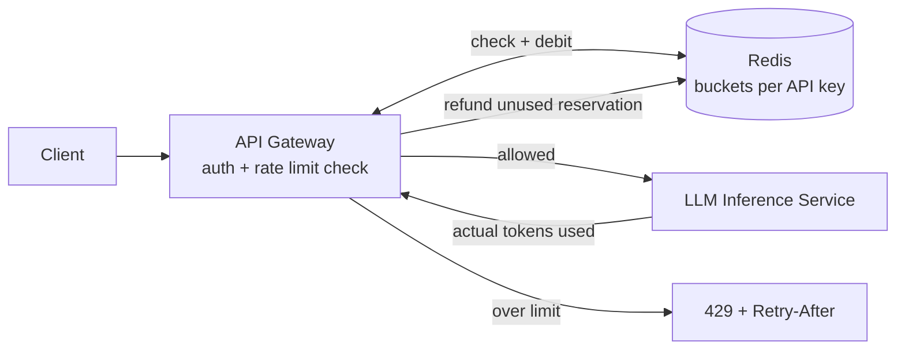
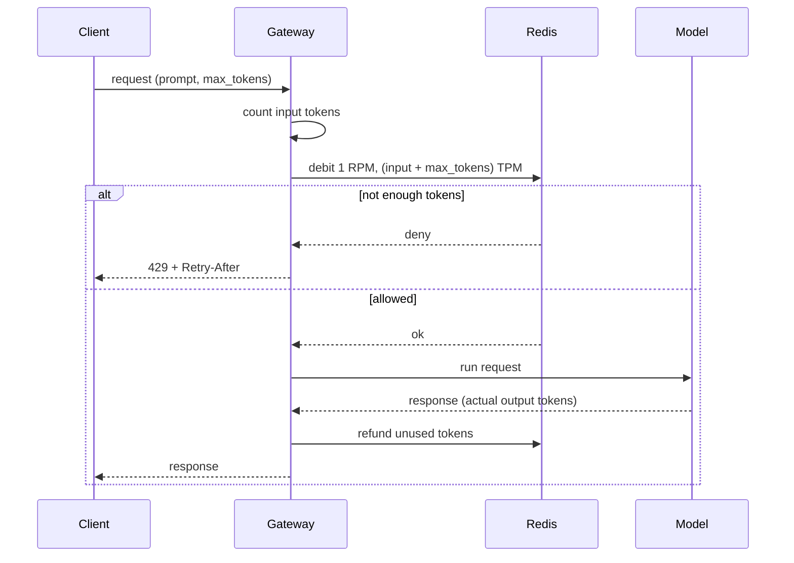

# W01 Baseline Design: Rate Limiter for a Public LLM API

## Requirements

- Limit each API key on:
  - **RPM** (requests per minute)
  - **TPM** (tokens per minute)
- Limits come from the customer's tier (e.g. free: 20 RPM / 40k TPM, paid: 500 RPM / 1M TPM).
- Over the limit: reject with `429 Too Many Requests` and tell the client when to retry.
- Low overhead: the check should add only a few ms.
- Works across many stateless API servers.

## Why LLM APIs need more than RPM

Requests vary a lot in cost. A one-line prompt and a 100-page summary each count as one request, but the second uses far more GPU. So limit **tokens** as well as requests.

Catch: you don't know the output length until the model finishes. Baseline approach:

1. On admission, reserve `input_tokens + max_tokens`.
2. When the response finishes, refund `max_tokens - actual_output_tokens`.

## Algorithm: token bucket

Each key has one bucket per limit (one for RPM, one for TPM).

- The bucket holds up to `capacity` tokens and refills at `rate` per second.
- A request costs 1 from the RPM bucket and N from the TPM bucket.
- If either bucket doesn't have enough, reject.
- Store only `tokens` and `last_refill_time`, and refill lazily on each check.

Why token bucket: simple, O(1) memory per key, allows short bursts, and handles variable cost (tokens) naturally. A fixed window is simpler but allows 2x bursts at window boundaries.

## Architecture



- **Gateway** authenticates the key, counts input tokens, and calls the limiter.
- **Redis** stores the buckets so every gateway instance sees the same counts. A small Lua script does check-and-debit atomically (no race between two gateways).
- Keys look like `rl:{api_key}:rpm` and `rl:{api_key}:tpm`.

## Request flow



## Response to client

```
HTTP 429
Retry-After: 2
x-ratelimit-remaining-requests: 0
x-ratelimit-remaining-tokens: 1200
```

Send the `x-ratelimit-*` headers on successful responses too, so clients can slow down before hitting the limit.

## Failure handling

- **Redis down or slow:** fail open, meaning allow the request (optionally with a rough per-server in-memory limit). Briefly over-admitting is better than blocking all paying customers.

## Tradeoffs

- **Reserving `max_tokens`** is safe but can block customers who set it high and use little. Refunding afterward fixes most of that.
- **Central Redis** gives accurate counts at the cost of one network hop per request. That's fine because LLM calls take seconds anyway.
- **Fail open vs. fail closed:** chose open for availability.

## Possible extensions (beyond baseline)

- Concurrency limits for long streaming requests
- Separate input vs. output token limits
- Global capacity protection / load shedding when GPUs are saturated (503 vs. 429)
- Multi-region quotas, hot-key handling
